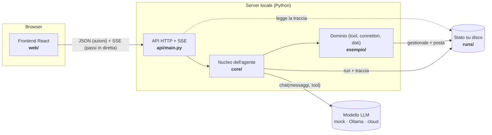
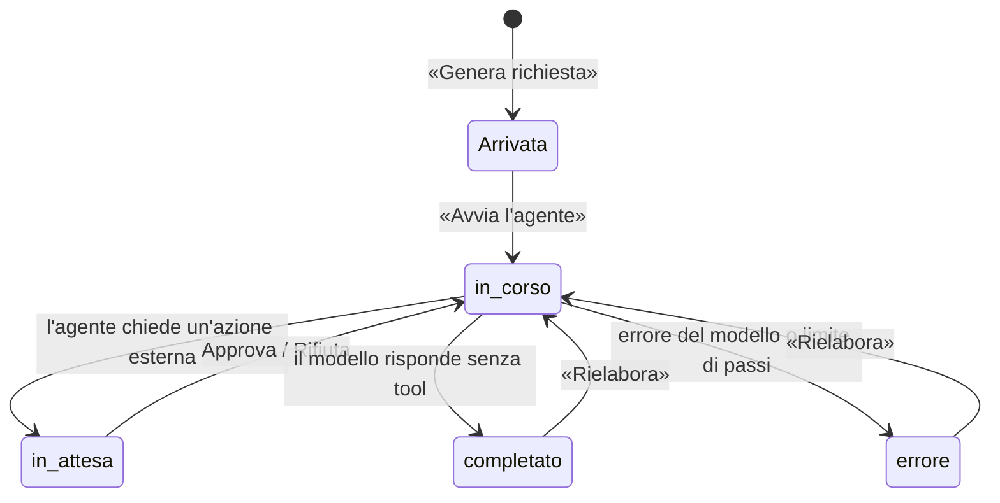
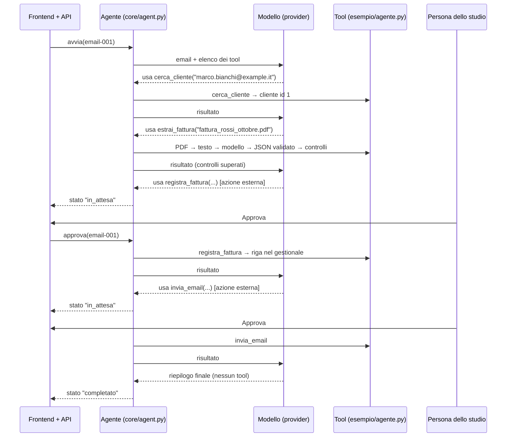

# Architettura

Cosa c'è nello starter kit, come funziona e perché è fatto così.

## L'idea in una frase

Un agente è un modello linguistico che lavora **in un ciclo**: a ogni giro decide se rispondere o
usare uno strumento (un *tool*: cercare un cliente, leggere un PDF, inviare un'email). Il codice
esegue il tool e gli rimanda il risultato. Le azioni che toccano il mondo esterno si fermano e
aspettano che una persona le approvi.

## Visione d'insieme



Il sistema è diviso in **quattro livelli**, ciascuno con una sola responsabilità:

| Livello | Cartella | Responsabilità | Cambia con il brief? |
|---|---|---|---|
| Interfaccia | `web/` | Mostrare lo stato e raccogliere le decisioni della persona. Nessuna logica dell'agente. | I testi e le descrizioni delle azioni (`azioni.ts`) sì, il resto no |
| API | `api/` | Tradurre HTTP in chiamate a `core/`. Espone solo ciò che serve alla UI (niente prompt, niente messaggi interni). | Poco: l'elenco della simulazione |
| Nucleo | `core/` | Ciclo dell'agente, tool, approvazioni, traccia, provider LLM. | **No** |
| Dominio | `esempio/` | Prompt, tool, connettori ai sistemi del cliente, dati di prova. | **Sì: si sostituisce** |

`ui/app.py` (Streamlit) è la prima interfaccia: resta come ripiego finché quella web non è collaudata.

In pratica il codice Python si divide in due:

- **`core/`**: la struttura che serve a qualunque brief (ciclo, tool, approvazioni, traccia, provider).
  Non contiene niente di specifico dello studio commercialista.
- **`esempio/`**: un dominio di prova costruito sopra `core/`. Al kick-off si sostituisce con il
  dominio del brief, mentre `core/` resta com'è.

### Dove vive lo stato

Non c'è un database dell'agente: tutto lo stato sta in file dentro `runs/` (ignorata da git).

| File | Contenuto | Chi lo scrive |
|---|---|---|
| `runs/inbox_arrivate.json` | quali richieste sono "arrivate" nella casella e quando | `api/` (pulsante «Genera richiesta») |
| `runs/<id>.run.json` | stato del run: conversazione, azione in attesa, risposta finale | `core/agent.py` |
| `runs/<id>.trace.jsonl` | un evento per riga: ogni passo dell'agente | `core/trace.py` |
| `runs/gestionale.db` | gestionale SQLite (clienti, pratiche, fatture) | `esempio/connettori.py` |
| `runs/posta_inviata.jsonl` | email "inviate" (finte: nessuna spedizione reale) | `esempio/connettori.py` |

Conseguenza utile: si può riavviare il backend, o ricaricare la pagina, senza perdere niente.
Il pulsante **Reset** cancella tutto questo e riparte da zero.

## Il ciclo di vita di una richiesta



## Il flusso del sistema, dall'inizio alla fine

1. **Arrivo.** La persona preme «Genera richiesta»: il frontend chiama `POST /api/simulazione/genera`
   e l'API aggiunge una email a `inbox_arrivate.json`. (In produzione questo passo sarebbe il
   server di posta dello studio; il resto del flusso non cambierebbe.)
2. **Avvio.** «Avvia l'agente» chiama `POST /api/richieste/{id}/elabora`. L'API passa il testo
   dell'email a `Agente.avvia()`. La chiamata resta aperta finché l'agente finisce o si ferma.
3. **Lavoro dell'agente.** Il ciclo (sezione 2 sotto) chiama il modello, esegue i tool di lettura
   e scrive ogni passo in `trace.jsonl`.
4. **Visibilità in diretta.** Nel frattempo il browser ha uno stream aperto
   (`GET /api/richieste/{id}/stream`, Server-Sent Events). L'API controlla il file di traccia ogni
   0,3 secondi e invia ogni nuovo evento: i passi compaiono uno alla volta, il più recente in alto.
5. **Pausa per l'approvazione.** Davanti a un'azione esterna il run diventa `in_attesa` e la
   chiamata del punto 2 termina. L'interfaccia mostra una scheda in italiano, con l'anteprima di
   ciò che verrà fatto.
6. **Decisione.** «Approva» (anche con dati corretti) o «Rifiuta» arrivano a `core/` e il ciclo riparte
   dal punto 3 con l'esito della decisione.
7. **Fine.** Il modello risponde senza chiedere tool: il run è `completato`, la risposta finale è
   mostrata e le tabelle dei sistemi dello studio riflettono ciò che è cambiato.

## Il flusso su un esempio vero (email-001)

Le stesse operazioni, viste tra i componenti. «Frontend + API» è l'insieme di `web/` e `api/`.



Ogni freccia che parte dall'agente viene registrata nella traccia: è quello che la UI mostra al centro.

## I pezzi, uno per uno

### 1. Provider LLM sostituibile: `core/llm.py`, `core/llm_mock.py`, `core/llm_openai.py`

Tutto il codice parla con il modello solo tramite `provider.chat(messaggi, tools) -> LLMResponse`.
I messaggi sono in un formato neutro (`Message`, `ToolCall`), quindi nessun file dipende da un
fornitore. Il provider si sceglie con `LLM_PROVIDER` nel file `.env`.

| Provider | Quando |
|---|---|
| `mock` (default) | sviluppo, test, demo offline. Risponde con le risposte registrate in `esempio/dati/mock/scenari.json`. Sceglie la risposta contando i messaggi già presenti nella conversazione, quindi non ha stato e funziona anche dopo una pausa. |
| `openai_compat` | modello vero. Un solo file copre Gemini, Mistral, Ollama/vLLM in locale e qualsiasi API compatibile con il formato OpenAI. |

**Perché:** si sviluppa e si testa senza spendere crediti; la UI e i connettori si costruiscono
senza aspettare i prompt; se l'API cade durante la demo si torna al mock; e nel pitch si può
dire "il modello si cambia, anche con uno open-source sul server del cliente".

### 2. Ciclo dell'agente: `core/agent.py`

`Agente.avvia()` crea un `Run` e lo porta avanti finché il modello risponde senza chiedere tool.
A ogni giro:

1. chiama il modello con la conversazione e l'elenco dei tool;
2. se il modello chiede dei tool, li mette in coda (`run.da_eseguire`);
3. esegue la coda: i tool di lettura subito; davanti a un tool **esterno** si ferma;
4. aggiunge i risultati alla conversazione e ricomincia.

Protezioni: massimo 12 chiamate al modello per run (`max_passi`); qualsiasi errore del
provider (rete, chiave, quota) porta il run in stato `errore` senza far cadere la UI.

**Stati di un run:**

```
in_corso ──► in_attesa ──(approva / rifiuta)──► in_corso ──► completato
    │                                                │
    └──────────────────► errore ◄────────────────────┘
```

Il run viene salvato in `runs/<id>.run.json` a ogni pausa e alla fine. Per questo la UI può
ricaricarsi (Streamlit riesegue lo script a ogni clic) senza perdere niente.

### 3. Registro dei tool: `core/tools.py`

Un tool è una normale funzione Python con il decoratore `@registry.tool()`. Dalla firma viene
generato lo schema JSON che vede il modello; la docstring diventa la descrizione.

- Gli argomenti proposti dal modello sono validati con **Pydantic** prima dell'esecuzione: tipi
  sbagliati o argomenti inventati diventano un errore leggibile che torna al modello, che può
  correggersi.
- `esegui()` non solleva mai eccezioni: anche un errore dentro il tool torna al modello come dato.

### 4. Approvazione umana: `external=True`

`@registry.tool(external=True)` segna un'azione verso l'esterno (inviare, registrare, modificare
dati di un cliente). Quando il modello la chiede:

- se gli argomenti non sono validi, l'errore torna subito al modello (inutile disturbare la persona);
- altrimenti il run va `in_attesa`. La persona può **approvare**, **correggere gli argomenti e
  approvare** (il modello viene avvisato della modifica) oppure **rifiutare** con un motivo (il
  modello lo legge e decide come proseguire).

**Perché:** è un principio dichiarato dallo sponsor ("le persone in controllo delle decisioni che
contano"), risponde alla domanda della giuria "e se sbaglia?" e copre GDPR (art. 22) e la
sorveglianza umana richiesta dall'AI Act.

### 5. Traccia dei passi: `core/trace.py`

Ogni evento (`inizio`, `llm`, `tool`, `in_attesa`, `approvato`, `rifiutato`, `modificato`, `fine`,
`errore`) è una riga JSON in `runs/<id>.trace.jsonl`, con ora e durata. Il formato è in
[contratto.md](contratto.md#traccia).

**Perché:** la UI la mostra come timeline (la giuria *vede* l'agente lavorare); è un registro
di audit; serve per il debug; e con le durate si misura il tempo per pratica, un numero da pitch.

### 6. Output strutturato ed estrazione documenti: `core/structured.py`, `esempio/documenti.py`

`chiedi_strutturato(provider, istruzioni, testo, Schema)` chiede al modello un JSON e lo valida
con uno schema Pydantic. Se non è valido (data nel formato sbagliato, campo mancante, JSON rotto)
rimanda l'errore al modello per un secondo tentativo. Usa solo testo, quindi funziona con ogni provider.

L'estrazione delle fatture segue lo schema **regola → modello → regola**:

1. `pdfplumber` estrae il testo dal PDF (deterministico, gratis);
2. il modello capisce quale numero è il totale, quale la data, ecc. e compila lo schema `Fattura`;
3. controlli deterministici: imponibile + IVA = totale, cifra di controllo della partita IVA,
   data non nel futuro. Trovano gli errori del documento (email-004) e quelli del modello.

### 7. Connettori finti: `esempio/connettori.py`

Inbox (`dati/inbox.json`), gestionale (SQLite, ricreato da `dati/gestionale_seed.sql`) e posta in
uscita (scrive su `runs/posta_inviata.jsonl`, non spedisce niente). Hanno la forma che avrebbero
quelli veri: per collegare Gmail si riscrive il corpo di `invia_email`, senza toccare agente e tool.
Tutti i dati sono sintetici (email `@example.it`, partite IVA con codice ufficio `000`, non assegnato).

### 8. API, interfaccia e verifica end-to-end: `api/`, `web/`, `scripts/demo_check.py`

- **`api/main.py`** è un sottile strato FastAPI sopra `core/`. Contiene solo la simulazione
  della casella email e la traduzione HTTP: nessuna logica dell'agente. Le rotte sono in
  [contratto.md](contratto.md#api-http-apimainpy-e-interfaccia-web-web).
- **`web/`** è l'interfaccia React, con due schermate (operativa e «Come ragiona l'agente»): come
  funzionano è in [frontend.md](frontend.md).
- **`ui/app.py`** (Streamlit) è la prima versione della UI, mantenuta come ripiego.

`demo_check.py` fa girare le quattro email con risposte registrate, approva tutto e controlla
stato, azioni, righe nel gestionale, email inviate e traccia. Usa una cartella temporanea, quindi
non tocca lo stato della UI.

## Scelte e limiti consapevoli

- **Niente framework per agenti** (LangChain, ADK, ...): il ciclo sta in circa 200 righe leggibili (commenti compresi),
  e lo si modifica in fretta durante l'hackathon. Se il brief richiede un framework, si sostituisce
  solo `core/agent.py`.
- **Niente database per lo stato dei run**: file JSON in `runs/`. Basta per una demo con un utente.
- **Un tool esterno alla volta**: se il modello chiede più azioni insieme, vengono approvate una
  dopo l'altra.
- **Un'elaborazione alla volta per richiesta**: `elabora` è una chiamata bloccante (la durata è
  quella del modello). I passi si vedono in diretta grazie allo stream, ma il backend non ha code
  né lavoratori in background. Per una demo basta; per più utenti contemporanei no.
- **Nessuna autenticazione** sull'API: pensata per girare in locale durante la demo.
- **L'adapter del modello vero non è ancora stato provato con una chiave**: è testato con un
  server HTTP finto. Va provato appena avete una chiave (vedi la guida).
