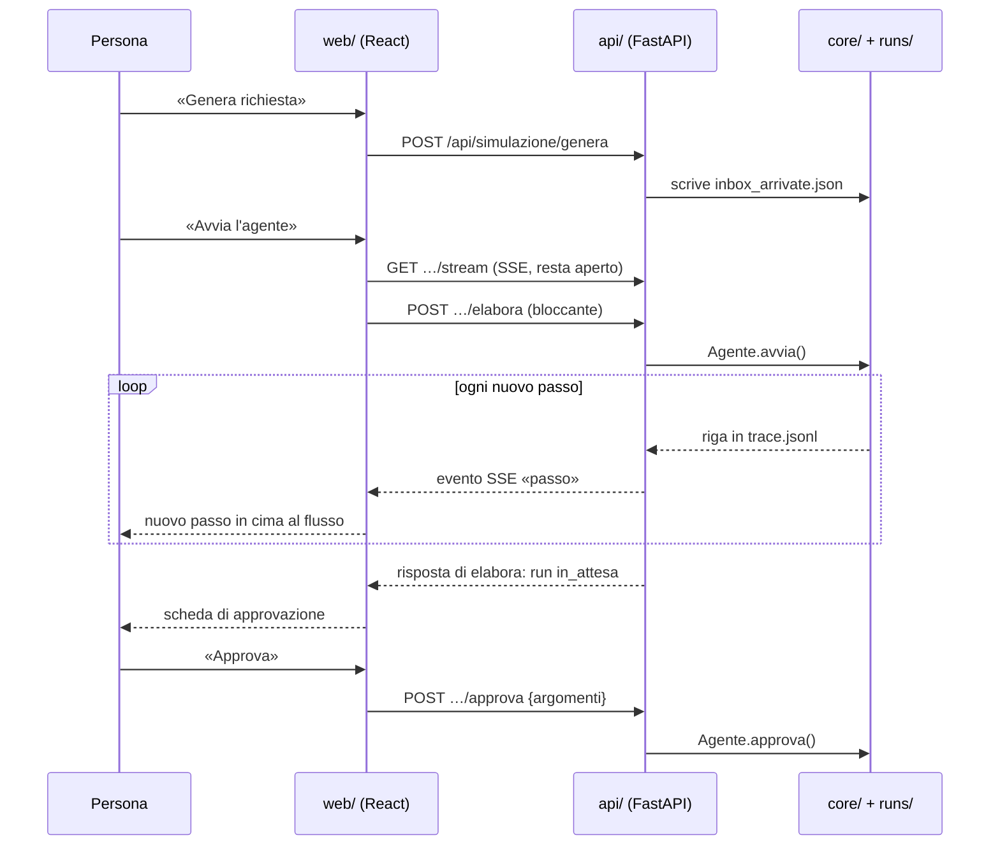

# Interfaccia web (`web/`)

Come funziona l'interfaccia, cosa vede e fa l'utente, e come si adatta a un nuovo brief.
Per il quadro generale vedi [architettura.md](architettura.md); le rotte sono in
[contratto.md](contratto.md#api-http-apimainpy-e-interfaccia-web-web).

## Due schermate

In alto a destra del titolo c'è un selettore (anche raggiungibile da `#ragionamento` nell'indirizzo):

| Schermata | A cosa serve |
|---|---|
| **Operatività** | Lavorare: generare richieste, avviare l'agente, approvare. Flusso compatto, più recente in alto. Descritta sotto. |
| **Come ragiona l'agente** | Capire: la stessa richiesta raccontata come una storia, dall'arrivo all'esito. Vedi [«Come ragiona l'agente»](#come-ragiona-lagente). |

Le due schermate condividono selezione, passi in diretta e azioni: si può avviare l'agente da una
e guardarlo nell'altra.

## A chi è rivolta

A una **persona dello studio** (una segretaria, un collaboratore), non a uno sviluppatore. Per questo:

- le operazioni sono descritte in italiano ("Registrare la fattura in contabilità"), non con i nomi dei tool;
- prima di approvare si vede **cosa succederà** (l'email com'è scritta, i dati della fattura), non un JSON;
- il JSON esiste, ma sta dietro il pulsante «Mostra dati tecnici», per utenti esperti.

## Stack

| Libreria | A cosa serve |
|---|---|
| React 19 + TypeScript + Vite | applicazione e build |
| Tailwind CSS v4 | stile, con token di colore per tema chiaro e scuro |
| Motion | animazioni (comparsa dei passi, schede) |
| React Flow (`@xyflow/react`) | vista a grafo del ragionamento |
| TanStack Query | chiamate all'API, cache e aggiornamento periodico |
| Lucide | icone |

## Le tre colonne

```
┌──────────────────┬─────────────────────────────────────┬────────────────────────┐
│ SIMULATORE       │ Oggetto della richiesta   [Avvia]   │  APPROVAZIONE          │
│ [Genera richiesta]│ Stato: In attesa                    │  (se l'agente aspetta) │
│                  │                                     │  Anteprima in italiano │
│ RICHIESTE        │ FLUSSO DELLE OPERAZIONI             │  [Approva] [Rifiuta]   │
│ • email-004 ◄ sel│  #6 ULTIMO  Serve il tuo ok…        │                        │
│ • email-001      │  #5  L'agente decide: …             │  oppure RIEPILOGO FINALE│
│                  │  #4  Cercare il cliente: eseguito   │                        │
│                  │  …                                  │  EMAIL DEL CLIENTE     │
├──────────────────┴─────────────────────────────────────┴────────────────────────┤
│ SISTEMI DELLO STUDIO (simulati): Pratiche · Fatture · Email inviate · Clienti    │
└──────────────────────────────────────────────────────────────────────────────────┘
```

### Sinistra: simulatore e richieste in arrivo

**Nessuna richiesta compare da sola.** La casella parte vuota. Il riquadro tratteggiato in alto
è il *simulatore*: **«Genera richiesta»** fa "arrivare" una nuova email di un cliente, presa da un
insieme di 8 email di prova (fatture, 730, mittente sconosciuto, pubblicità…). Il testo del
riquadro dice sempre che cosa viene simulato e quante richieste di prova restano.

- Il pulsante genera la **prossima** email dell'elenco.
- La freccia accanto permette di **scegliere quale** far arrivare (utile per decidere l'ordine della demo).
- Quando sono finite, il pulsante diventa «Tutte arrivate». «Reset» svuota di nuovo la casella.
- Le richieste arrivate appaiono sotto, **la più recente in alto**, con un pallino colorato di stato.

> In produzione questo riquadro sparirebbe: le email arriverebbero dal server di posta dello
> studio e il resto dell'interfaccia funzionerebbe uguale. Il testo spiegato dal simulatore si
> cambia in `SORGENTE_SIMULATA` (`api/main.py`).

### Centro: il flusso delle operazioni

Mostra **ogni passo** dell'agente, **dal più recente al più vecchio**: l'ultimo è sempre in alto,
evidenziato con l'etichetta ULTIMO, quindi non serve scorrere per sapere a che punto è.

Ogni passo ha: numero, ora e durata, un titolo in italiano e, se serve, una riga di dettaglio
(per esempio il ragionamento dell'agente o "2 risultati"). Cliccando si aprono i **dati tecnici**
del passo (argomenti e risultato in JSON). Sono possibili due viste: **Timeline** (elenco) e
**Grafo** (il modello in alto, i tool al centro, le decisioni umane in basso).

| Passo | Cosa significa per l'utente |
|---|---|
| Richiesta ricevuta | l'agente ha preso in carico l'email |
| L'agente decide: … | il modello ha scelto la prossima operazione |
| *Nome operazione*: eseguito / non riuscito | un tool è stato eseguito, con l'esito |
| Serve il tuo ok | l'agente si è fermato e aspetta una decisione |
| Approvato / Rifiutato da te | la decisione presa |
| Hai corretto i dati | gli argomenti sono stati modificati prima dell'approvazione |
| Lavoro completato / Qualcosa è andato storto | fine del run |

### Destra: approvazione, esito, email originale

**Scheda di approvazione** (compare solo se l'agente aspetta una decisione):

1. il titolo dell'azione ("Inviare un'email", "Registrare la fattura in contabilità");
2. **«Perché»**: l'ultimo ragionamento dell'agente prima di fermarsi;
3. l'**anteprima**: per un'email, destinatario, oggetto e testo come li riceverà il cliente; per
   una fattura o una pratica, un elenco di campi con importi in euro, date in formato italiano e il
   cliente per nome (non per numero);
4. **Se approvi / Se rifiuti**: una riga su cosa succede nei due casi;
5. i **dati tecnici** nascosti dietro un pulsante: aprendoli si può correggere il JSON, e l'azione
   userà quei valori;
6. **Approva** o **Rifiuta** (con motivo facoltativo).

Sotto: il **riepilogo finale** quando il lavoro è completato, o l'errore; e l'**email originale** del cliente.

### In basso: sistemi dello studio

Quattro schede (pratiche, fatture registrate, email inviate, clienti) mostrano **cosa è cambiato
davvero** dopo le approvazioni. Sono simulati: nessuna email parte e nessun dato reale è toccato.

## Tutti i casi d'uso

| Situazione | Cosa succede |
|---|---|
| Prima apertura | Casella vuota e guida in tre passi al centro: genera, avvia, approva |
| «Genera richiesta» | Arriva la prossima email, selezionata in automatico |
| Scegliere quale generare | Menu a tendina con le email ancora da far arrivare |
| Tutte generate | Pulsante «Tutte arrivate» disabilitato |
| «Avvia l'agente» | I passi compaiono in diretta; il pulsante diventa «In corso…» |
| Azione esterna da approvare | Stato «Da approvare» (pallino arancione), scheda a destra |
| Approva | L'azione viene eseguita; l'agente prosegue e può chiedere un'altra approvazione |
| Correggere prima di approvare | «Mostra dati tecnici», modifica, Approva: il passo «Hai corretto i dati» resta nella traccia |
| JSON non valido | Messaggio in rosso, Approva disabilitato |
| Rifiuta (con o senza motivo) | L'azione non parte; l'agente legge il rifiuto e di solito scrive al cliente |
| Lavoro completato | Riquadro verde con il riepilogo; tabelle aggiornate |
| Errore (modello non raggiungibile, troppi passi) | Riquadro rosso con il messaggio; si può «Rielabora» |
| «Rielabora» | La traccia riparte da zero (evento `reset` nello stream) |
| Passare a un'altra richiesta | Si chiude lo stream precedente e se ne apre uno nuovo |
| Mittente sconosciuto / spam | L'agente non inventa e non agisce, oppure chiede chiarimenti |
| «Reset» | Svuota casella, run, tracce, gestionale e posta |
| Backend spento | Schermata con il comando per avviarlo |

## Come ragiona l'agente

Schermata pensata per **spiegare** (a una giuria, a un cliente, a un collega) cosa arriva, come
lavora l'agente, cosa decide e perché. A sinistra restano il simulatore e l'elenco; a destra una
storia in cinque capitoli, preceduta da una barra con le tappe (**Arrivo › Comprensione ›
Raccolta dati › Azioni e approvazione › Esito**) che si colorano man mano.

| Capitolo | Cosa mostra |
|---|---|
| **1 · Cosa è arrivato** | L'email completa (da, data, oggetto, testo), gli allegati (cliccandoli si vede il **testo del PDF che l'agente legge**) e, a richiesta, il testo esatto che riceve l'agente |
| **2 · Chi è l'agente e cosa può fare** | Il modello in uso, gli strumenti divisi in *«può farlo da solo»* (sola lettura) e *«serve la tua approvazione»* (azioni esterne), e le istruzioni complete date all'agente (a richiesta) |
| **3 · Come ragiona, passo dopo passo** | Per ogni giro del ciclo: **Cosa pensa e perché** (il testo del modello), **Cosa decide di fare** (una frase per ogni operazione, con l'etichetta sola lettura / azione esterna) e **Cosa ottiene** (il risultato in linguaggio umano: cliente trovato, dati della fattura, esito dei controlli automatici, errori). Il primo passo è la **presa in carico** (capisce che richiesta è), l'ultimo la conclusione |
| **4 · Ora tocca a te** | Compare quando l'agente si ferma: la stessa scheda di approvazione della schermata operativa, con anteprima e «Perché» |
| **5 · Come è finita** | Quattro numeri (ragionamenti, operazioni, tue decisioni, tempo dell'agente), l'elenco di **cosa è stato fatto** e di cosa è stato **rifiutato**, e il **riepilogo dell'agente** (cosa ha fatto e perché) |

Mentre l'agente lavora la pagina scorre da sola all'ultimo passo.

**Da dove viene il «perché».** Il modello è istruito a scrivere una frase prima di ogni strumento
(vedi `SYSTEM_PROMPT` in `esempio/agente.py`). Quella frase è ciò che la schermata mostra come
«Cosa pensa e perché». Se un modello non la scrive, compare *«Il modello non ha spiegato questo
passo»*: non viene mai inventata una spiegazione. Con il modello finto i testi sono quelli
registrati in `scenari.json`.

**Codice:** `components/Ragionamento.tsx` (la schermata), `fasi.ts` (raggruppa i passi grezzi in
«fasi» e associa a ogni operazione il suo esito e la decisione umana), `azioni.ts` (`frase()` e
`leggiEsito()` traducono operazioni e risultati; da adattare al brief).

## Come i dati arrivano allo schermo



Oltre allo stream, TanStack Query rilegge stato, richieste e dettaglio ogni 1,5-2 secondi:
è una rete di sicurezza (per esempio se un altro browser cambia lo stato).

## Mappa del codice

| File | Cosa fa |
|---|---|
| `src/App.tsx` | Layout, stato della selezione, azioni (elabora, approva, rifiuta, reset), badge di stato |
| `src/api.ts` | Tipi TypeScript e chiamate `fetch`: **specchio di `docs/contratto.md`** |
| `src/hooks.ts` | `usePassi(id)`: segue lo stream SSE di una richiesta |
| `src/azioni.ts` | **Traduzione in italiano** di tool e passi; anteprima delle azioni. È il file da adattare al brief |
| `src/passi.ts` | Icone, colori e etichette degli stati |
| `src/components/GeneraRichiesta.tsx` | Simulatore dell'arrivo delle email |
| `src/components/Inbox.tsx` | Elenco delle richieste arrivate |
| `src/components/Timeline.tsx` | Flusso dei passi, più recente in alto |
| `src/components/Grafo.tsx` | Vista a grafo (React Flow) |
| `src/components/Ragionamento.tsx` | Schermata «Come ragiona l'agente» |
| `src/fasi.ts` | Raggruppa i passi della traccia in fasi (pensiero, decisione, esito, intervento umano) |
| `src/components/Approvazione.tsx` | Scheda di approvazione con anteprima |
| `src/components/Sistemi.tsx` | Tabelle dei sistemi dello studio |
| `src/index.css` | Token di colore (tema chiaro/scuro), Tailwind |

## Adattarla a un nuovo brief

1. **`src/azioni.ts`**: aggiungi i nomi leggibili dei nuovi tool in `NOME_TOOL`; per ogni azione
   esterna un caso in `descrivi()` (titolo, campi, anteprima); e un caso in `frase()` e
   `leggiEsito()` per la schermata «Come ragiona». Un tool non
   elencato funziona comunque, con un testo di ripiego generato dal nome.
2. **`api/main.py`**: aggiorna `SORGENTE_SIMULATA` (cosa simula «Genera richiesta»).
3. **`src/components/Sistemi.tsx`**: cambia le schede in base ai dati del nuovo dominio
   (e la rotta `/api/sistemi` in `api/main.py`).
4. **Testi** in `App.tsx` (titolo, guida in tre passi).

`core/` e il resto dell'interfaccia non si toccano.

## Sviluppo

```bash
# terminale 1, dalla cartella del repo
source .venv/bin/activate
LLM_PROVIDER=mock uvicorn api.main:app --reload --port 8000

# terminale 2
cd web && npm install && npm run dev      # http://localhost:5173
```

In sviluppo Vite inoltra `/api` alla porta 8000 (vedi `vite.config.ts`). Controlli: `npx tsc -b`
(tipi), `npx oxlint` (lint), `npm run build` (build di produzione in `web/dist/`).
